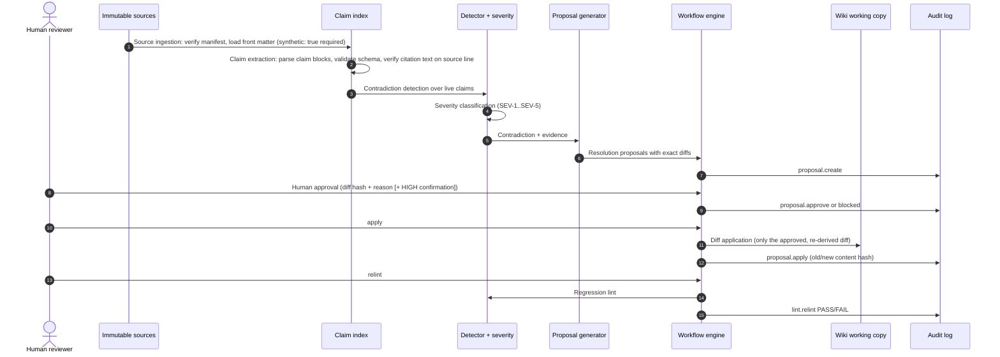

# Architecture

## Overview

```text
fixtures/kb/sources/*.md  ──(sha256 manifest)──┐
                                               ▼
fixtures/kb/wiki/*.md ──copy──► .lab/<workspace>/wiki ──► loadKnowledgeBase ──► Claim[] + StructuralFinding[]
                                                                                      │
                                                     detectContradictions ◄───────────┘
                                                              │ Contradiction[] (+ classifySeverity)
                                                              ▼
                                                     generateProposals ──► proposals/PRP-*.json
                                                              │
                                approve / reject / apply (workflow/engine.ts) ──► audit.jsonl (hash chain)
                                                              │
                                                 apply writes wiki pages (guarded) + log.md entry
                                                              │
                                                     relint: compareLint(baseline, now)
```

There is no server and no database: everything is files plus pure functions, which makes every step testable in
isolation and the whole loop reproducible.

## Sequence



## Modules

| Module                       | Responsibility                                                                         |
| ---------------------------- | -------------------------------------------------------------------------------------- |
| `src/domain/predicates.ts`   | predicate registry (kind, cardinality, category, time-varying, unit), ordering rules   |
| `src/domain/schemas.ts`      | Zod schemas: Claim, Contradiction, Proposal, AuditEvent                                |
| `src/kb/sources.ts`          | source loading, front matter, manifest compute/verify                                  |
| `src/kb/wiki.ts`             | wiki page loading, claim-block parsing, claim-block editing, open-question append      |
| `src/kb/knowledge-base.ts`   | builds typed claims, verifies citations, structural findings, fails closed on manifest |
| `src/detect/detector.ts`     | pairwise comparison, date intervals, contradiction records, recommended action         |
| `src/detect/severity.ts`     | published severity rules and classifier                                                |
| `src/lint/lint.ts`           | lint report and regression delta                                                       |
| `src/resolve/proposals.ts`   | resolution drafts per contradiction, page edits, unified diffs, proposal hashing       |
| `src/workflow/workspace.ts`  | workspace creation (marker-guarded), paths, protected directories                      |
| `src/workflow/audit.ts`      | append-only hash-chained log, verification, fail-closed append                         |
| `src/workflow/engine.ts`     | propose / approve / reject / apply / relint, staleness, state from audit log           |
| `src/llm/advisor.ts`         | optional advisor interface, prompt builder, strict response validation, fixtures       |
| `src/context/experiment.ts`  | context-window batching experiment                                                     |
| `src/benchmark/benchmark.ts` | deterministic benchmark and report                                                     |
| `src/report/format.ts`       | terminal rendering shared by CLI and demo                                              |
| `src/util/*`                 | sha256 + canonical JSON, LCS unified diff, guarded atomic write, clocks                |

## Records

**Contradiction**: `id` (`CTR-` + 8 hex of the sorted claim-id pair, so it stays stable across runs), `claimIds` (older
source first), `subject`, `predicates`, `type` (`direct | temporal | numeric | status`), `explanation`, `confidence`,
`severity`, `severityRules`, `sourceRefs` (claim, source, line, date, page), `recommendedAction`, `state`
(`open | under-review`).

**Proposal**: `id` (`PRP-` + 8 hex of contradiction id, action and basis hash), `contradictionId`, `severity`, `action`,
`rationale`, `affectedPages`, `affectedClaimIds`, `expectedResult`, `expectedOutcome`
(`resolves | under-review | follow-up-recorded`), `riskWarning`, `humanApprovalRequired: true`,
`highSeverityConfirmationRequired`, `basis` (page hashes + claim fingerprints at creation), `changes` (page, old/new
hash, new content, unified diff), `diffHash`. A schema refinement rejects any HIGH proposal without the confirmation flag.

**Audit event**: `seq`, `timestamp`, `operation`, `actor`, `contradictionId`, `proposalId`, `sourceClaimIds`,
`oldContentHash`, `newContentHash`, `proposalHash`, `diffHash`, `result` (`success | blocked | failed`), `reason`,
`prevHash`, `hash` = sha256(canonical JSON of all other fields).

## Resolution actions

| Action                   | Offered when                                   | Patch                                              | Outcome            |
| ------------------------ | ---------------------------------------------- | -------------------------------------------------- | ------------------ |
| `keep-newer`             | same predicate, source dates differ            | older claim `status: superseded`, `superseded_by`  | resolves           |
| `keep-older`             | same predicate, source dates differ            | newer claim superseded                             | resolves           |
| `mark-obsolete`          | cross-predicate (ordering rule), one per claim | chosen claim `status: obsolete`                    | resolves           |
| `preserve-both-temporal` | time-varying predicate, source dates differ    | both claims get `as_of: <source date>`             | resolves           |
| `request-human-review`   | always                                         | both claims `status: disputed`, `review: required` | under-review       |
| `request-new-source`     | always                                         | open question appended to each affected page       | follow-up-recorded |

Recommended action: HIGH → `request-human-review`; equal or missing dates → `request-new-source`; cross-predicate →
`mark-obsolete`; time-varying → `preserve-both-temporal`; otherwise → `keep-newer`.

## Design decisions

- **Structured claims, not text similarity.** Contradictions are defined over normalized `(subject, predicate,
value)` with predicate semantics. Different predicates are never compared unless an explicit ordering rule links
  them, which is how "PostgreSQL for transactions" and "Redis for caching" stay compatible.
- **Date precision as intervals.** `2026-03` means 1 to 31 March, so a refinement (`2026-05` vs `2026-05-19`) is
  compatible and ordering rules compare the earliest and latest possible days.
- **Claims are never deleted.** Resolutions change status or add metadata, so history stays readable and a wrong
  resolution can itself be reviewed.
- **The approval binds to bytes.** Proposals are hashed in canonical JSON. Approval records the proposal hash and the
  diff hash. Apply re-derives the diff from the live page and compares it byte for byte. The LCS diff is implemented
  in-repo so its output cannot drift with a dependency upgrade.
- **Staleness is checked twice.** `staleness()` compares page hashes and claim fingerprints with the proposal basis.
  `apply` also checks each page hash against the change's `oldHash`. Either check alone blocks a stale apply.
  (A mutation test that disabled the first check showed the second still blocking, which is why both are kept.)
- **State from the log.** Proposal state (`proposed → approved → applied`, or `rejected`) is derived from audit
  events, so changing a decision means forging a hash-chained entry, not editing a status field.
- **Fail closed.** A modified source stops loading. A broken audit chain stops every write and every append.
  An invalid proposal file is reported as blocked.
- **Deterministic IDs and an injectable clock.** The demo, benchmark and tests use a fixed clock, so outputs are
  byte-identical across runs.

## Failure behaviour

| Condition                                   | Behaviour                                             | Exit (CLI) |
| ------------------------------------------- | ----------------------------------------------------- | ---------- |
| source file edited, added or removed        | `SourceIntegrityError`, nothing loads                 | 2          |
| audit log edited/reordered/deleted line     | `AuditTamperError` on next append; `audit-log` BROKEN | 2 / 1      |
| proposal file edited                        | `proposal-tampered` (audited as blocked)              | 1          |
| page or claim changed since proposal        | `stale-proposal` on approve and apply                 | 1          |
| apply without approval / after rejection    | `approval-required` / `proposal-rejected`             | 1          |
| HIGH approve without confirmation           | `high-severity-confirmation-required`                 | 1          |
| regression introduces a contradiction/error | relint `failed`                                       | 1          |
| init over a non-workspace directory         | refused; nothing deleted                              | 2          |
